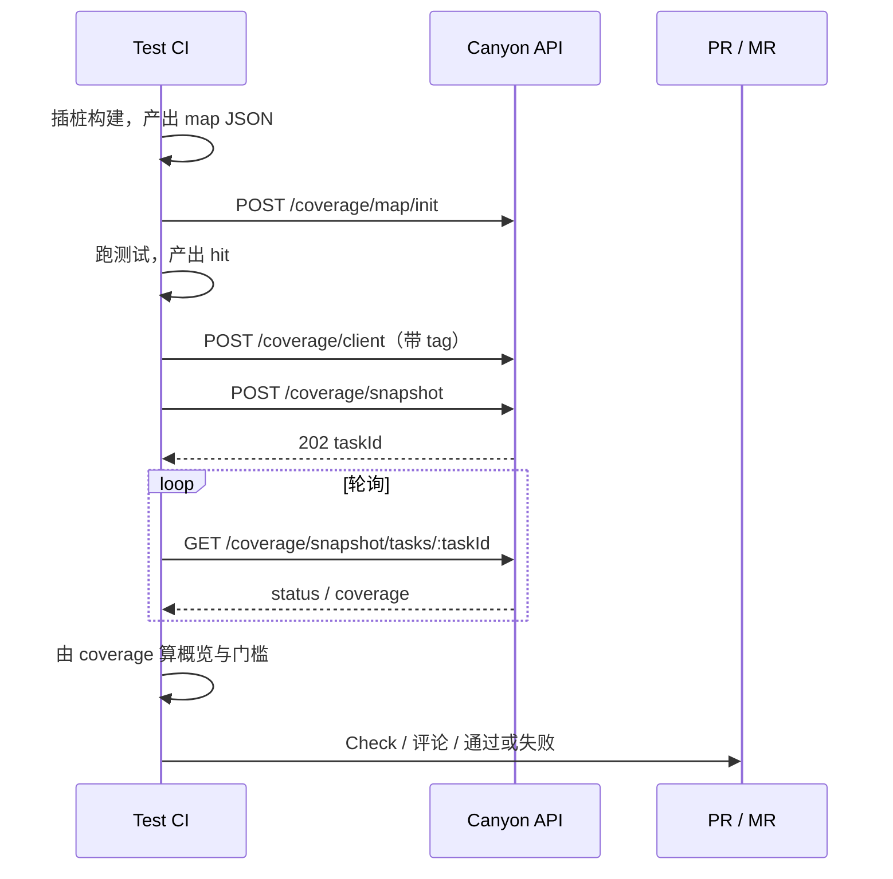

# PR / MR CI 集成（总览）

本文说明在 **Pull Request / Merge Request** 的 test CI 里，如何走完：

**初始化 map → 上报 hit → 创建快照 → 轮询状态 → 计算概览 → 回写覆盖率检查状态。**



假设 API 基址为 `CANYON_API`（例如 `https://canyon.example.com` 或本地 `http://localhost:8080`）。

---

## 0. 前置条件

1. 服务端已部署，`DATABASE_URL` 已迁移。
2. 前端插桩构建能产出 Istanbul 风格 JSON（含 `statementMap`、`inputSourceMap`、`buildHash`、`s` 等）。可参考仓库内 `packages/real-app` 的 `.canyon_output`。
3. 同一流水线内，**init / client / snapshot 使用同一个 `buildHash`**。
4. CI 能访问 Canyon API（内网或带鉴权的网关；当前开源实现未强制鉴权，生产请自行加）。

---

## 1. 初始化 Map — `POST /coverage/map/init`

在**构建完成、测试开始前**（或测试结束后但必须先于 hit 上报）调用。

### 请求体

路径 → 文件覆盖率对象（与仪器输出一致）。至少包含：

- `path`
- `statementMap`
- `buildHash`
- 可选：`inputSourceMap`、`provider`、`repoID`、`sha`、`buildTarget`、`instrumentCwd`

同批数据的 `buildHash` 必须一致。

```bash
curl -sS -X POST "$CANYON_API/coverage/map/init" \
  -H 'Content-Type: application/json' \
  --data-binary @coverage-map.json
```

### 成功响应 `201`

```json
{
  "buildHash": "05a03384e493af486c63dfff78180d64ec1dd040",
  "fileCount": 7
}
```

### CI 注意

- 可把 `.canyon_output/*.json` 合并成一个对象再上传。
- 重复 init 同一 `buildHash`：map 行为 insert + conflict doNothing，不会覆盖更新。
- **未 init 就上报 client 会 400**。

---

## 2. 上报命中 — `POST /coverage/client`

测试跑完后，把**命中**按场景 tag 上报。每次都是直接 insert，不做合并（合并留给快照）。

### 请求体

```json
{
  "tag": {
    "source": "automation",
    "type": "e2e",
    "env": "test",
    "trigger": "pipeline"
  },
  "coverage": {
    "/abs/path/to/build/main.js": {
      "path": "/abs/path/to/build/main.js",
      "s": { "0": 1, "1": 0, "2": 3 },
      "buildHash": "05a03384e493af486c63dfff78180d64ec1dd040"
    }
  }
}
```

- `coverage` 为回溯后的 Istanbul 单文件结构（含 `statementMap`、`s` 等）及 `buildHash`。
- 多种测试类型应**分别上报**不同 `tag`（例如 unit 一次、e2e 一次）。

```bash
curl -sS -X POST "$CANYON_API/coverage/client" \
  -H 'Content-Type: application/json' \
  -d @coverage-client-e2e.json
```

### 成功响应 `201`

```json
{
  "buildHash": "05a03384e493af486c63dfff78180d64ec1dd040",
  "tagKey": "…sha256…",
  "hitCount": 7
}
```

### CI 建议 tag

| Job      | tag 示例                                                                           |
| -------- | ---------------------------------------------------------------------------------- |
| 单元测试 | `{ "type": "unit", "env": "test", "source": "automation", "trigger": "pipeline" }` |
| E2E      | `{ "type": "e2e", "env": "test", "source": "automation", "trigger": "pipeline" }`  |

快照时若不传筛选，会聚合该 `buildHash` 下全部 tag；若只想看 e2e，创建快照时传 `"tag": { "type": "e2e" }`。

---

## 3. 创建快照 — `POST /coverage/snapshot`

所有需要纳入本次检查的 hit 上报完成后调用。

### 请求体

```json
{
  "buildHash": "05a03384e493af486c63dfff78180d64ec1dd040",
  "tag": { "env": "test" }
}
```

- `tag` **可选**。不传 = 该 build 下全部 tag。
- 传了则按字段 **AND + jsonb 包含** 筛选（未写的字段不限制）。

### 响应

- `202`：任务已创建

```json
{ "taskId": "0ccb22e5-0311-4590-8ad8-c143cd625b28", "status": "pending" }
```

- `409`：同 `buildHash` 已有未超时的 `running` 任务

```json
{
  "error": "同 buildHash 已有快照任务在执行",
  "taskId": "已有任务 id",
  "status": "running"
}
```

遇到 `409` 时，应改为轮询返回的 `taskId`，不要再开一个并行快照。

服务端后台会：

1. 压缩同 `buildHash + tagKey + file` 的多行 hit；
2. 拼 `statementMap` + `inputSourceMap`；
3. 用 `@canyon/data` 回溯到**源码**覆盖率；
4. 写入 `canyon_next6_snapshot`。

默认执行中会额外 sleep 约 10 秒（`SNAPSHOT_TASK_SLEEP_MS`，测试可设为 `0`）。

---

## 4. 轮询任务 — `GET /coverage/snapshot/tasks/:taskId`

```bash
TASK_ID=...
while true; do
  RESP=$(curl -sS "$CANYON_API/coverage/snapshot/tasks/$TASK_ID")
  STATUS=$(echo "$RESP" | jq -r '.status')
  echo "status=$STATUS"
  case "$STATUS" in
    succeeded|failed|rejected) break ;;
  esac
  sleep 2
done
```

### 成功时响应字段（节选）

```json
{
  "taskId": "…",
  "buildHash": "…",
  "status": "succeeded",
  "tagFilter": { "env": "test" },
  "snapshotId": "…",
  "error": null,
  "coverage": {
    "/repo/packages/app/src/App.tsx": {
      "path": "/repo/packages/app/src/App.tsx",
      "s": { "0": 1, "1": 1, "2": 0 },
      "buildHash": "…"
    }
  },
  "createdAt": "…",
  "startedAt": "…",
  "finishedAt": "…"
}
```

- `status !== succeeded`：读 `error`，CI 应失败并打印原因。
- `coverage` 的 key 已是**源码路径**。

建议超时：例如 10～15 分钟（视仓库大小与 `SNAPSHOT_TASK_SLEEP_MS`）。

---

## 5. 从 coverage 得到「概览」与「覆盖率状态」

快照本身不存汇总数字，由 CI **本地根据 `coverage` 计算**。

### 语句覆盖率概览

对每个文件：`s` 里值 `> 0` 的条目数 / 总条目数；再汇总全仓库：

```js
function summarize(coverage) {
  let covered = 0;
  let total = 0;
  const files = [];

  for (const [filePath, file] of Object.entries(coverage || {})) {
    const values = Object.values(file.s || {});
    const fileTotal = values.length;
    const fileCovered = values.filter((n) => n > 0).length;
    covered += fileCovered;
    total += fileTotal;
    files.push({
      path: file.path || filePath,
      covered: fileCovered,
      total: fileTotal,
      pct: fileTotal === 0 ? 100 : (fileCovered / fileTotal) * 100,
    });
  }

  return {
    statementsCovered: covered,
    statementsTotal: total,
    pct: total === 0 ? 100 : (covered / total) * 100,
    files,
  };
}
```

### 覆盖率状态（给 PR/MR 用）

由概览 + 你们的门槛决定，例如：

| 状态      | 条件示例                              |
| --------- | ------------------------------------- |
| `success` | `pct >= 80`                           |
| `failure` | `pct < 80` 或快照 `failed` / 轮询超时 |
| `neutral` | 仅告警、不挡合并                      |

输出给后续步骤的建议 JSON：

```json
{
  "buildHash": "…",
  "taskId": "…",
  "snapshotId": "…",
  "statementsCovered": 1200,
  "statementsTotal": 1500,
  "pct": 80.0,
  "conclusion": "success"
}
```

---

## 6. 回写 PR / MR

拿到 `conclusion` 与概览后：

**GitHub**

- [Checks API](https://docs.github.com/en/rest/checks/runs) 创建 Check Run：`conclusion = success | failure`
- 或 `gh pr comment` 贴上 `pct` 与文件列表摘要

**GitLab**

- [Commit statuses API](https://docs.gitlab.com/ee/api/commits.html#set-the-pipeline-status-of-a-commit)：`state = success | failed`
- 或 MR Note 评论

门槛未达标时，让该 CI job **exit non-zero**，即可挡住合并（取决于分支保护规则）。

更具体的 workflow 文件见：

- [GitHub Actions 示例](/guide/ci/github-actions)
- [GitLab CI 示例](/guide/ci/gitlab-ci)

---

## 推荐流水线顺序（务必遵守）

1. Install / 插桩构建
2. **`map/init`**（拿到并固定 `BUILD_HASH`）
3. 跑测试（可并行多 job，各自 `client` 上报不同 tag）
4. 汇总 job：**`snapshot` → 轮询 → 算概览 → 回写状态**
5. （可选）打开 `apps/app` 的 Coverage 页人工查看任务与结果

不要在 snapshot 仍 `running` 时对同一 `buildHash` 再开快照；不要在 init 之前上报 client。

---

## 排错速查

| 现象                           | 可能原因                                                       |
| ------------------------------ | -------------------------------------------------------------- |
| client 400「buildHash 不存在」 | 未 init，或 buildHash 不一致                                   |
| snapshot 409                   | 已有 running；改用返回的 taskId 轮询                           |
| 任务 failed：missing keys      | 组装 istanbul 缺字段（服务端应已补 fnMap/branchMap；升级 API） |
| coverage 仍是 build 路径       | 旧版本未做回溯；确认使用带 `@canyon/data` remap 的 API         |
| 轮询一直 pending               | 进程未执行后台任务 / 锁未释放；看 API 日志与任务 `error`       |
