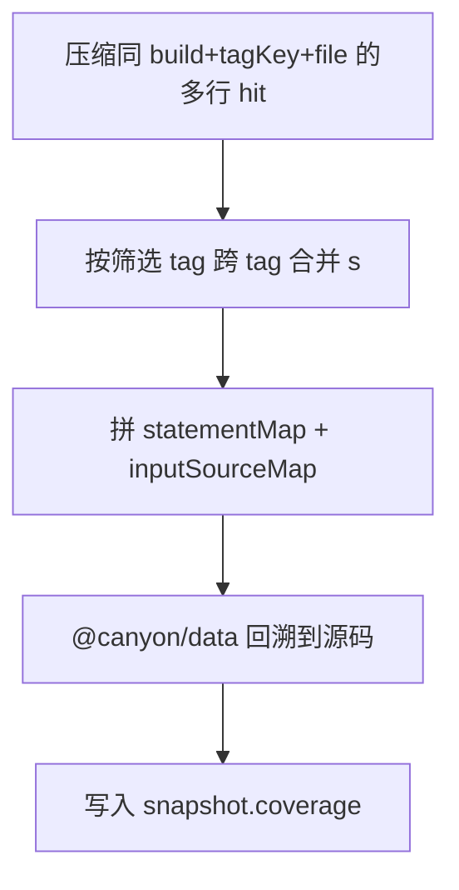

# 核心概念

## 为什么拆 Map 和 Hit

插桩后的 Istanbul 数据里，**结构**（`statementMap` / `inputSourceMap`）很大且相对稳定；**命中**（`s`）随测试运行变化、体积小。

Canyon 把二者拆开：

| 概念         | 何时产生          | 存什么                                          |
| ------------ | ----------------- | ----------------------------------------------- |
| **Map**      | 构建 / `map/init` | `statement_map` + 内容寻址的 `input_source_map` |
| **Hit**      | 测试 / `client`   | 仅语句命中 `s`，带 `tagKey`                     |
| **Snapshot** | CI 主动创建       | 聚合 + 回溯后的源码覆盖率 JSON                  |

同一仓库连续 commit 往往只改少量文件，多数文件的 `inputSourceMap` 内容相同，因此 sourcemap 按内容 hash 去重存储。

## buildHash

一次「可对齐的覆盖率构建」用 `buildHash` 标识。客户端在 map 与 hit 里都要带上同一个 `buildHash`。

- 必须先 `POST /coverage/map/init`，再 `POST /coverage/client`
- 快照按 `buildHash` 聚合；同一 `buildHash` 同时只允许一个快照任务在跑

## Tag

上报 hit 时携带场景标签：

```json
{
  "source": "automation",
  "type": "e2e",
  "env": "test",
  "trigger": "pipeline"
}
```

- `tagKey = sha256(stableStringify(规范化后的四元组))`
- 缺省字段视为空串
- 快照筛选：不传 tag = 全部；传部分字段则用 jsonb 包含匹配（例如 `{ "type": "e2e" }`）

常见拆分：

| 维度      | 示例                           |
| --------- | ------------------------------ |
| `type`    | `e2e` / `unit` / `integration` |
| `env`     | `test` / `staging`             |
| `source`  | `automation` / `manual`        |
| `trigger` | `pipeline` / `local`           |

## 快照在做什么



落库结构（每个源码文件）：

```json
{
  "/path/to/src/App.tsx": {
    "path": "/path/to/src/App.tsx",
    "statementMap": { "0": { "start": { "line": 1, "column": 0 }, "end": { "line": 1, "column": 10 } } },
    "fnMap": {},
    "branchMap": {},
    "s": { "0": 1, "1": 0, "2": 3 },
    "f": {},
    "b": {},
    "buildHash": "..."
  }
}
```

结构与 Istanbul 单文件 coverage 一致（回溯后的 **源码** `statementMap` + `s` 等）。`path` 已是源码路径（不是打包后的 `build/*.js`）。

## 任务状态

| status      | 含义                                              |
| ----------- | ------------------------------------------------- |
| `pending`   | 已创建，等待执行                                  |
| `running`   | 执行中（默认还会 sleep 约 10s，可用环境变量关掉） |
| `succeeded` | 完成，可取 `coverage`                             |
| `failed`    | 失败，看 `error`                                  |
| `rejected`  | 未抢到锁等，未执行                                |

CI 应轮询直到 `succeeded` / `failed` / `rejected`。
